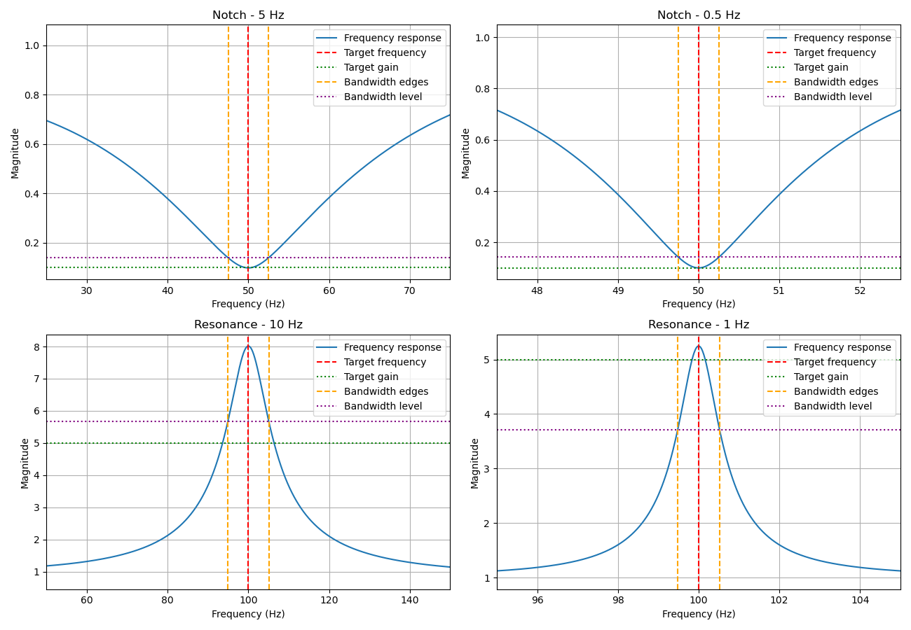
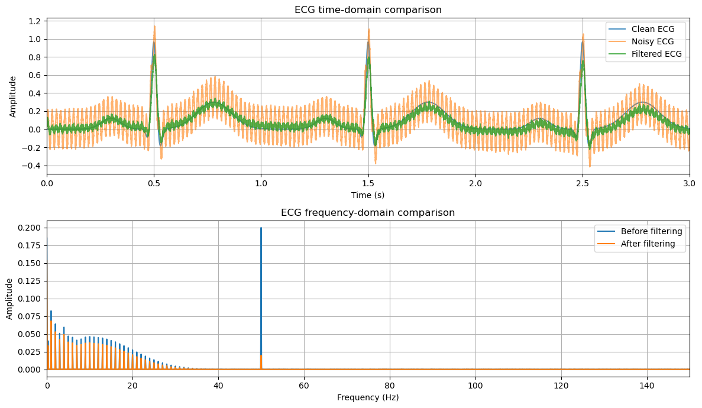
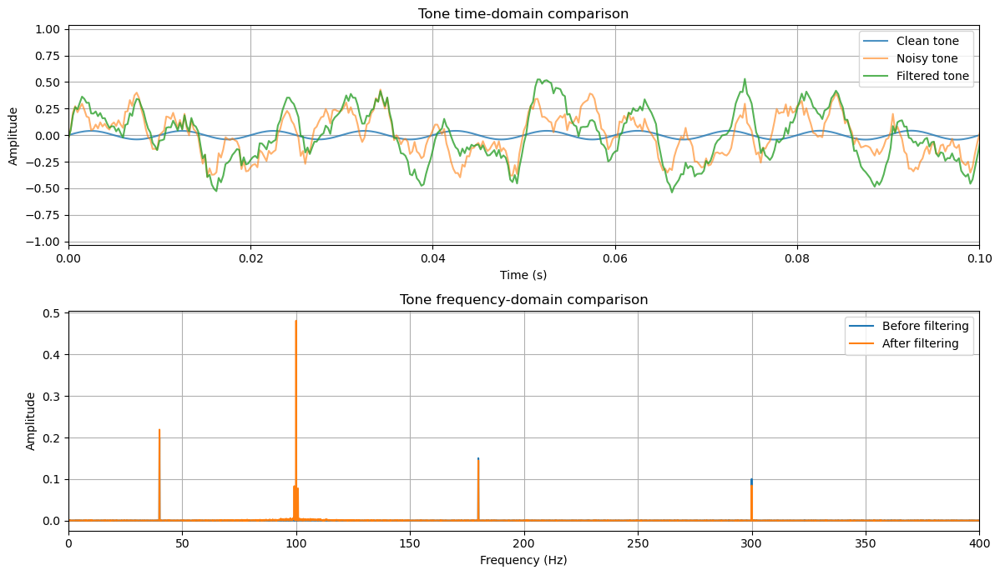
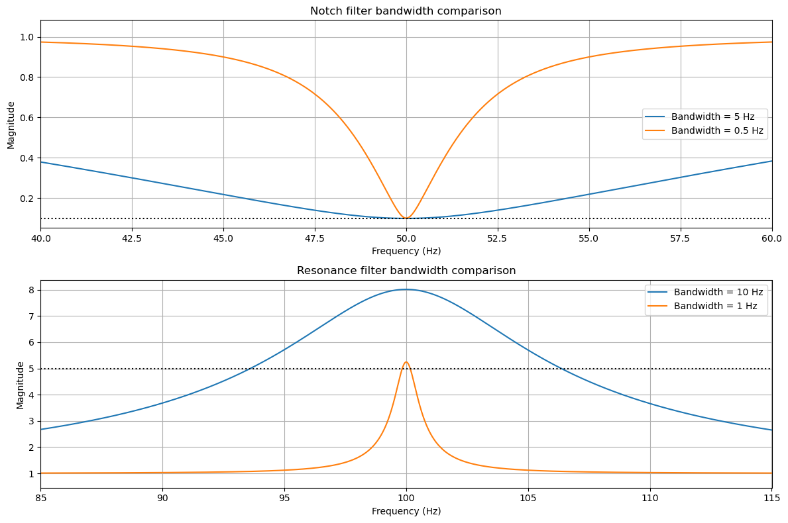

# Second-Order IIR Filter Design Using Pole–Zero Placement

**DSP assignment — implementation, numerical validation, and signal experiments**

This project implements the second-order IIR parametric equalizer design method described by Van Waterschoot and Moonen (2007). Two types of filters are studied:

- **Notch filters**, which attenuate a selected frequency region.
- **Resonance filters**, which amplify a selected frequency region.

The objective is to calculate the filter coefficients from the requested specifications, evaluate the resulting frequency responses, and apply the filters to example signals. The results also show where the approximate design equations do not match the requested gains exactly.

## 1. Filter design method

The second-order transfer function is

$$
H(z)=K\frac{1-2r_z\cos(\omega_c)z^{-1}+r_z^2z^{-2}}
{1-2r_p\cos(\omega_c)z^{-1}+r_p^2z^{-2}},
$$

where $r_z$ and $r_p$ are the zero and pole radii, $\omega_c$ is the center angular frequency, and $K$ is a gain factor. The implemented function returns the numerator and denominator coefficients:

$$
\begin{aligned}
b &= [K,\;-2Kr_z\cos(\omega_c),\;Kr_z^2],\\
a &= [1,\;-2r_p\cos(\omega_c),\;r_p^2].
\end{aligned}
$$

The function `design_biquad_filter(G0, Gc, B, wc)` takes:

| Parameter | Meaning |
|---|---|
| `G0` | Requested reference gain (DC gain for the resonance normalization) |
| `Gc` | Requested gain at the center frequency |
| `B` | Bandwidth in radians/sample |
| `wc` | Center angular frequency in radians/sample |

When the frequency and bandwidth are given in hertz, they are converted using

$$
\omega_c = \frac{2\pi f_c}{f_s}, \qquad B = \frac{2\pi\,\mathrm{BW}}{f_s}.
$$

The implementation uses the paper's **approximate pole–zero placement expressions**. It handles $0<G_c/G_0<1$ (notch), $G_c/G_0\geq2$ (resonance), and $G_c/G_0=1$ (constant gain). The intermediate amplification range $1<G_c/G_0<2$ is not implemented. For the notch branch, the current code sets $K=G_0$; this does not guarantee that the *actual* DC gain equals $G_0$.

## 2. Project files

| File | Description |
|---|---|
| `design_biquad_filter.py` | Calculates the IIR numerator and denominator coefficients. |
| `validate_filter.py` | Evaluates four filter designs, reports gain and bandwidth errors, checks pole/zero radii and stability, and plots the responses. |
| `generate_signals.py` | Creates four reproducible synthetic WAV files: clean and noisy ECG-like signals, and clean and noisy tone-like signals. |
| `filter_analysis.ipynb` | Applies the designed filters, compares signals in the time and frequency domains, and calculates experimental metrics. |

The four figures below are saved as PNG files in the repository root.

## 3. Numerical validation

All four designs were tested at a sampling frequency of **4,000 Hz** with $G_0=1$.

| Filter | $f_c$ | Target BW | Target $G_c$ | Measured gain at $f_c$ | Gain error | Measured BW | BW error |
|---|---:|---:|---:|---:|---:|---:|---:|
| Notch | 50 Hz | 5 Hz | 0.1 | 0.098732 | −1.27% | 5.008561 Hz | +0.17% |
| Notch | 50 Hz | 0.5 Hz | 0.1 | 0.100145 | +0.15% | 0.500070 Hz | +0.01% |
| Resonance | 100 Hz | 10 Hz | 5 | 8.014332 | +60.29% | 10.152023 Hz | +1.52% |
| Resonance | 100 Hz | 1 Hz | 5 | 5.246629 | +4.93% | 1.039014 Hz | +3.90% |

The frequency responses are computed with `scipy.signal.freqz`. The bandwidth is estimated from the two crossings of the selected amplitude level around the response minimum or maximum, using linear interpolation between neighboring frequency samples. For the tested cases, the notch level is $\sqrt{2}$ times the measured minimum gain and the resonance level is the measured maximum gain divided by $\sqrt{2}$.



*Figure 1. Frequency responses for the two notch and two resonance designs. Blue: calculated response; red dashed: target center frequency; green dotted: target center gain; orange dashed: measured bandwidth boundaries; purple dotted: bandwidth measurement level.*

All four tested filters have poles strictly inside the unit circle and satisfy the expected pole–zero radius ordering. Therefore, **these four configurations are stable**. This does not establish stability for every possible input to the design function.

The measured DC gains are **0.827824** and **1.001074** for the 5 Hz and 0.5 Hz notch filters, respectively. In particular, the 5 Hz notch has a **−17.22% DC-gain error**, despite its small error at the center frequency. Both tested resonance filters have DC gain approximately equal to 1.

The 10 Hz resonance filter has the largest center-gain error: it reaches approximately **8.01 instead of 5**. The 1 Hz resonance filter is closer to the requested gain, but its relative bandwidth error is larger. These observations demonstrate that a stable filter with the expected pole–zero placement does not necessarily meet every requested specification accurately when approximate design expressions are used.

## 4. Signal experiments

Two **synthetic**, 10-second signals were generated at 4,000 Hz. Clean references are available because the signals were constructed programmatically. These examples are useful for controlled testing, but they are **not real-life recordings**.

### 4.1 ECG-like signal: 50 Hz notch filtering

The ECG-like waveform contains simulated P, Q, R, S, and T components. The noisy version adds a 50 Hz sinusoidal interference, low-frequency baseline wander, and white noise.

A notch filter was applied with $f_c=50$ Hz, $\mathrm{BW}=5$ Hz, $G_0=1$, and $G_c=0.1$.



*Figure 2. Time-domain comparison of clean, noisy, and filtered ECG-like signals (top), and frequency-domain comparison before and after filtering (bottom).*

The 50 Hz component is strongly attenuated after filtering, and the time-domain waveform follows the clean reference more closely. The filter does not remove all disturbances: baseline wander and some residual noise remain.

The notebook reports the following mean squared errors (MSE) relative to the clean synthetic reference:

| Metric | Value |
|---|---:|
| MSE before filtering | 0.021026 |
| MSE after filtering | 0.002597 |
| MSE reduction | **87.65%** |

The MSE reduction is specific to this generated example and is not a general estimate of ECG denoising performance.

### 4.2 Tone-like signal: 100 Hz resonance filtering

The desired signal is an amplitude-modulated 100 Hz tone. The noisy mixture additionally contains 40 Hz, 180 Hz, and 300 Hz components, together with white noise.

A resonance filter was applied with $f_c=100$ Hz, $\mathrm{BW}=10$ Hz, $G_0=1$, and $G_c=5$.



*Figure 3. Time-domain comparison of clean, noisy, and filtered tone-like signals (top), and frequency-domain comparison before and after filtering (bottom).*

The 100 Hz component is amplified considerably. The other frequency components remain visible because this is a **resonance filter**, not a general-purpose noise suppression filter. Consequently, the filtered waveform is not expected to reproduce the clean tone exactly.

The notebook measures the amplitude at 100 Hz as follows:

| Metric | Value |
|---|---:|
| Amplitude before filtering | 0.060166 |
| Amplitude after filtering | 0.481256 |
| Measured amplitude ratio | **7.9988** |
| Requested center gain | **5.0000** |

The measured amplitude ratio is consistent with the numerical frequency-response result (approximately 8.014 at 100 Hz). The small difference reflects measurement and finite-signal effects. This experiment confirms amplification of the desired frequency, but also illustrates the gain inaccuracy of this particular approximate design.

## 5. Effect of bandwidth

The two notch configurations were compared at 50 Hz using bandwidths of **5 Hz** and **0.5 Hz**. The two resonance configurations were compared at 100 Hz using bandwidths of **10 Hz** and **1 Hz**.



*Figure 4. Frequency-response comparison for the two notch bandwidths (top) and the two resonance bandwidths (bottom). The dotted horizontal lines indicate the requested center gains.*

For the notch filter, reducing the bandwidth produces a more localized attenuation around 50 Hz. The 0.5 Hz case also preserves the reference gain more accurately outside the narrow attenuation region.

For the resonance filter, the 1 Hz bandwidth produces a narrower peak and a center gain closer to the requested value. However, its relative bandwidth error is approximately **3.90%**, compared with **1.52%** for the 10 Hz case. A narrower bandwidth therefore does not automatically improve every accuracy metric.

## 6. Limitations and conclusions

The implemented method successfully produces notch and resonance responses for the four tested configurations. The poles are inside the unit circle in each test, and the filters exhibit the expected attenuation or amplification behavior.

However, the numerical experiments show that **stability and the expected response shape do not imply exact compliance with the requested gains**. The 5 Hz notch has a substantial DC-gain error, while the 10 Hz resonance has a substantial center-gain error. These deviations should be considered when using the approximate equations.

The experiments have three further limitations:

1. Only four parameter combinations were checked; the implementation was not exhaustively tested over its supported input ranges.
2. The frequency-response measurements use a discrete numerical grid and interpolation, so the reported frequencies and bandwidths are estimates.
3. Both signal experiments use **synthetic data**, not measured or recorded real-life signals. If the assignment requires at least two real-life signals, additional experiments with actual recordings are necessary before treating the submission as complete.

## 7. Reproducing the results

Use Python with `numpy`, `scipy`, `matplotlib`, and Jupyter installed. From the repository root, run:

```bash
python -m pip install numpy scipy matplotlib notebook
python generate_signals.py
python validate_filter.py
jupyter notebook filter_analysis.ipynb
```

In the notebook, select **Restart Kernel and Run All Cells**. `generate_signals.py` writes the synthetic WAV files to `signals/`; the notebook writes filtered WAV files to `output/`. These generated folders are not required in version control because their contents can be recreated.

## Reference

Van Waterschoot, T., and Moonen, M. (2007). *A Pole-Zero Placement Technique for Designing Second-Order IIR Parametric Equalizer Filters.* The implementation follows the approximate design expressions discussed in this paper.
